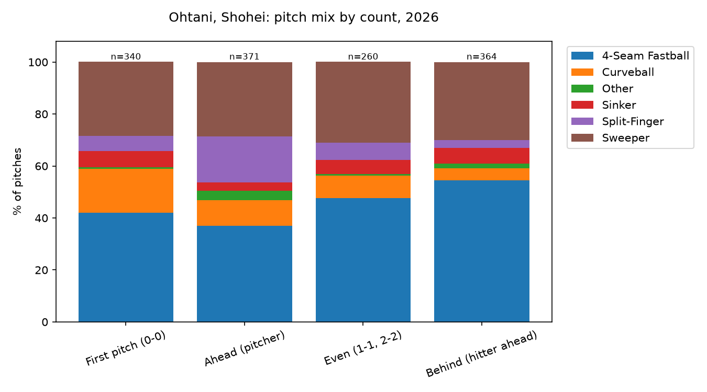
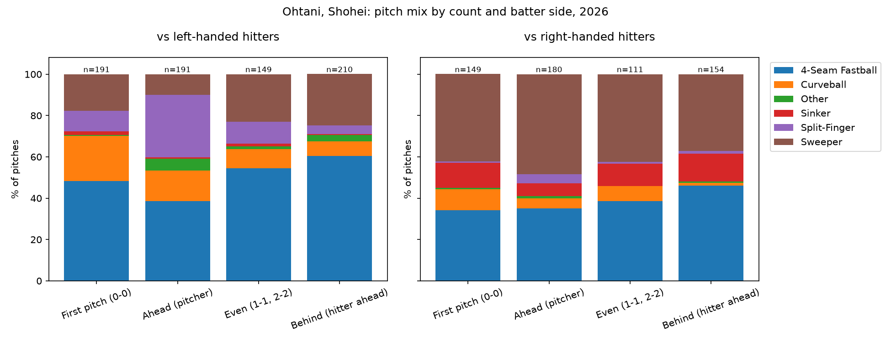

# Pitch mix by count

A small Python project showing what one pitcher throws when he is ahead, even, or behind in the
count, overall and against left vs. right-handed hitters. 

## Question
How does a certain pitcher's pitch selection change with the count, and does it differ by batter side?

## Data
Pitch-by-pitch Statcast data for one pitcher and season from Baseball Savant (Statcast Search CSV).

## Method
- Counts are grouped into four situations: first pitch (0-0), ahead (more strikes than balls), even (1-1, 2-2), and behind (more balls than strikes).
- For each situation, the share of each pitch type is calculated. Pitch types used under 3% of the time are grouped as "Other".
- The same table is made separately for left- and right-handed hitters.

## Run it
```bash
python -m pip install -r requirements.txt
```
1. Open `pitch_mix.py` and set `PITCHER_ID` (the number at the end of the pitcher's Baseball Savant URL) and `SEASON`.
2. Run `python pitch_mix.py`.

If the download fails, use Statcast Search on baseballsavant.mlb.com, download the CSV, and save it as
`data/pitcher.csv`. The script will use that file.

## Results



[Two or three sentences: what changes with the count, what is different against lefties vs righties, and one thing a hitter might do with this information.]

## Limitations
- One pitcher and one season, so some count situations have small samples (the chart shows n for each).
- Pitch mix also depends on the hitter, the score, the inning and the pitcher's health, which this ignores.
- Statcast's pitch classification is automatic and can mislabel some pitches.

## Next steps
- Compare two pitchers, or the same pitcher across seasons.
- Add pitch location to see where each pitch is thrown by count.
- Build a one-page scouting report from several of these charts.
